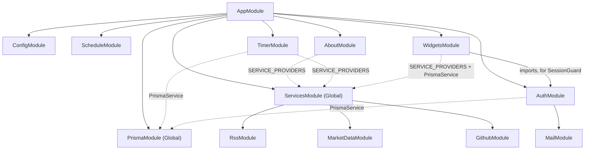
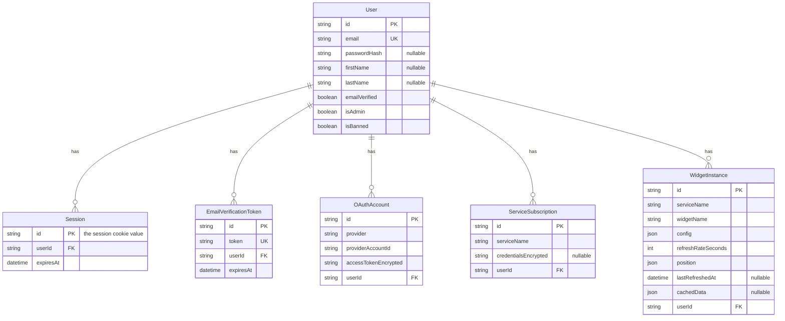
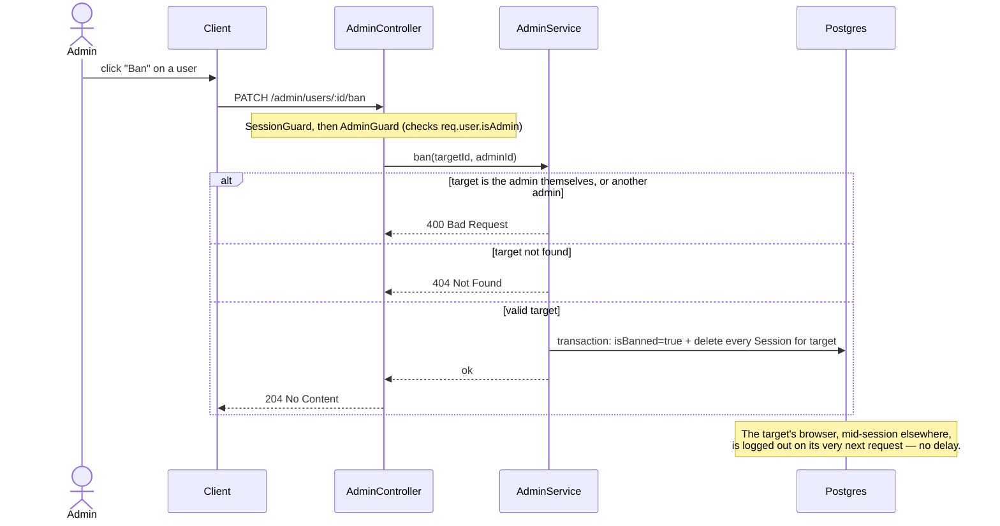
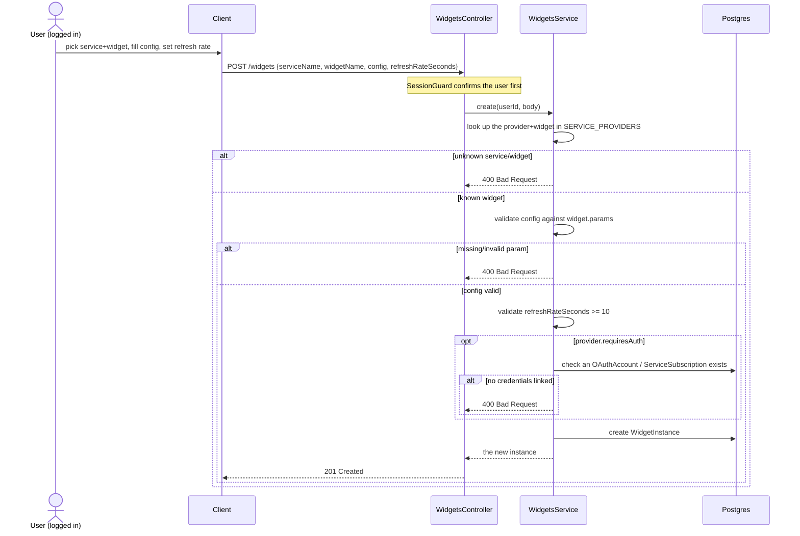
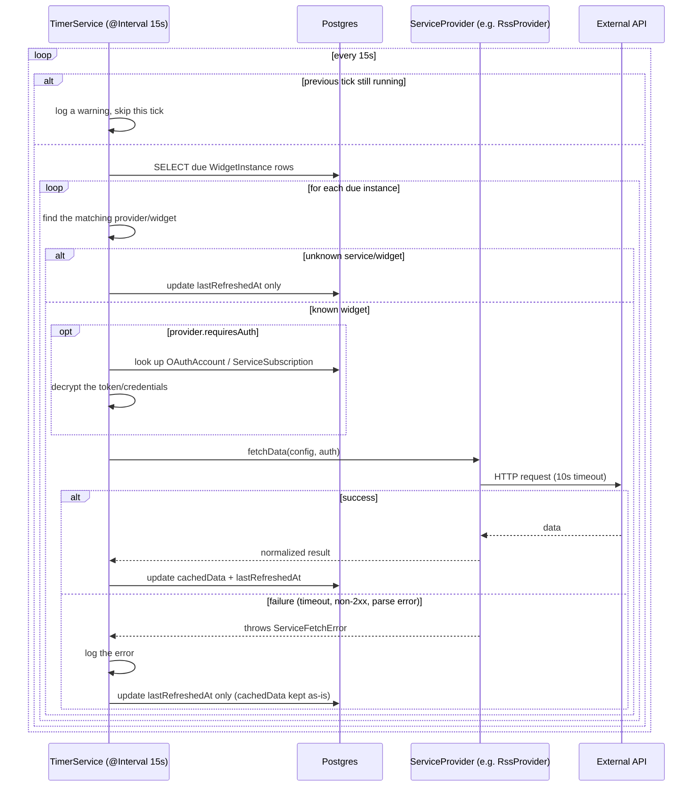
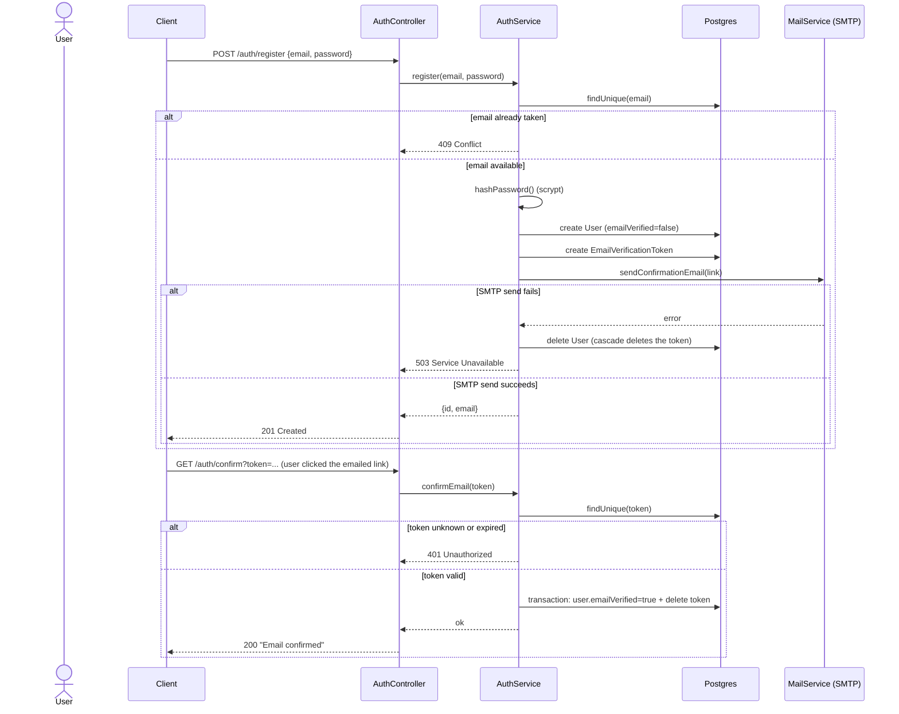
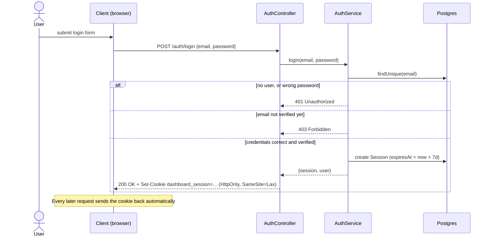
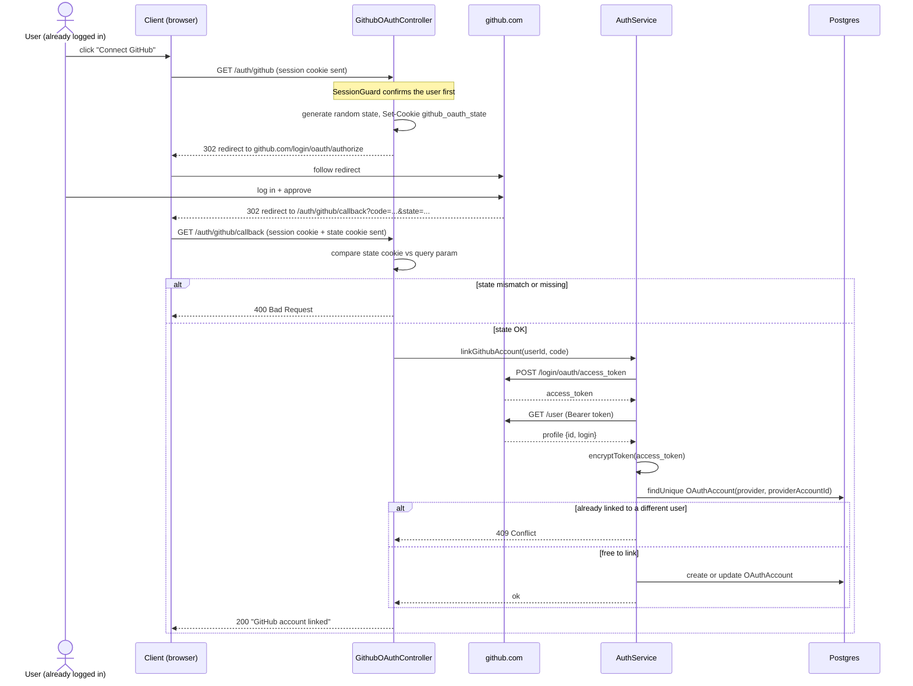
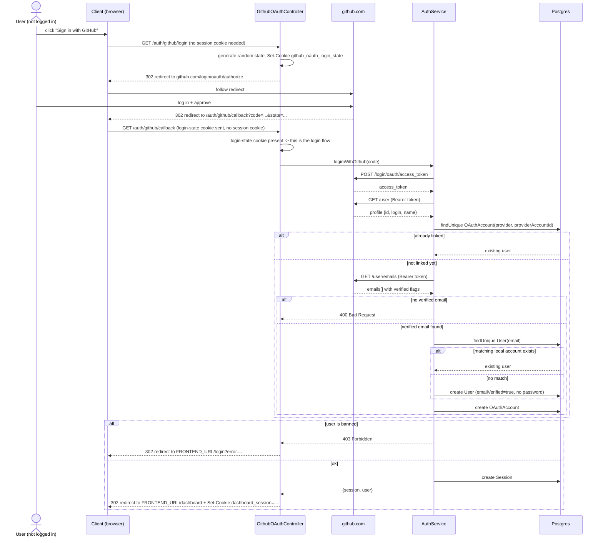

# Architecture

Technical documentation for developers/contributors. For a general overview (install, usage, feature
list), see [README.md](./README.md).

## Directory layout

```
/backend
  /src
    /auth        # signup, email confirmation, session login/logout, GitHub OAuth + linking
    /admin       # user management: list/ban/unban/delete (admin-only)
    /mail        # SMTP sending (Mailhog in dev, a real provider in prod)
    /prisma      # PrismaService/PrismaModule (the DB client, not the schema itself)
    /services
      service-provider.interface.ts   # the ServiceProvider/WidgetDefinition contract
      service-providers.token.ts      # DI token for the registry
      services.module.ts              # wires every concrete provider into the registry
      /rss           # done
      /market-data   # done
      /github        # done (+ a repos endpoint feeding the frontend's repo picker)
      /weather       # not started (Morayo)
      /steam         # not started (Morayo)
      /maps          # not started (Morayo)
    /widgets     # widget instance CRUD (add/reconfigure/move/delete)
    /timer       # refresh scheduler
    /about       # generates GET /about.json from the registered ServiceProviders
    /common      # cross-cutting utils (token encryption)
  prisma/
    schema.prisma
    migrations/
/frontend        # React/Vite/Tailwind — see FRONTEND.md for its own structure and status
  /src
    /components
    /pages
    /hooks
/bonus
docker-compose.yml
```

## Module graph

Solid arrows are Nest module imports; dashed arrows are "injects a provider from a `@Global` module
without importing it" (`PrismaModule` and `ServicesModule` are both `@Global`, so `TimerModule` and
`AboutModule` use `PrismaService`/`SERVICE_PROVIDERS` without listing those modules in their own
`imports`).



## `ServiceProvider` / `WidgetDefinition` contract

File: `backend/src/services/service-provider.interface.ts`.

Each service (weather, github, rss, ...) implements `ServiceProvider`: it declares its name, whether it
requires authentication, and its list of `WidgetDefinition`s (name, description, configurable params,
`fetchData` function). `GET /about.json` is generated automatically by iterating over the registered
`ServiceProvider`s — no duplication between the API doc and the code.

`fetchData` must never let a raw exception leak: any external call failure must be converted into a
`ServiceFetchError` (typed, carrying `serviceName`/`widgetName`), caught by the scheduler so it marks the
instance as errored without crashing the global tick or the other widgets.

## Data model (Prisma)

File: `backend/prisma/schema.prisma`.



- **User** — platform account. `passwordHash` is nullable (an account can be created via OAuth only),
  `emailVerified` blocks login until confirmation has happened. `firstName`/`lastName` are **required**
  at registration and editable afterward via `PATCH /auth/me` (self) or `PATCH /admin/users/:id`
  (admin) — added on request after the fact, not part of the original design; `register`/`login`/
  `getUserBySession` all funnel through a shared `toPublicUser()` projection in `auth.service.ts` so the
  three stay in sync. `isAdmin`/`isBanned` — see [Admin](#admin-user-management) below.
- **Session** — a server-side session record; its `id` is the unguessable value stored in the login
  cookie. Deleting a row logs that session out immediately (see Authentication below).
- **EmailVerificationToken** — time-limited token for signup email confirmation.
- **OAuthAccount** — a third-party account linked to a `User`. Linking is resolved by matching the
  provider's verified email against an existing `User`, never by auto-creating a duplicate. Tokens are
  stored encrypted (`accessTokenEncrypted`/`refreshTokenEncrypted`), never in plaintext.
- **ServiceSubscription** — a non-OAuth service subscription (plain credentials), also encrypted at rest.
- **WidgetInstance** — one widget instance placed on a user's dashboard: `config` (validated against the
  `WidgetDefinition`'s `params`), `refreshRateSeconds`, `position` (for react-grid-layout), `cachedData` +
  `lastRefreshedAt` (last result cached by the scheduler).

## Admin (user management)

Listed by the brief as "very useful" rather than mandatory — built anyway; the standard for this project
is to cover everything the brief mentions, not just what's required.

Files: `backend/src/admin/`. Every route is `SessionGuard` + `AdminGuard` (in that order — `AdminGuard`
only reads `req.user.isAdmin`, which `SessionGuard` is what attaches, so it must run second and depends
on it having run first).

- **Becoming an admin** — deliberately has no API endpoint. The only paths are `ADMIN_EMAILS` in `.env`
  (checked once, at registration) or a direct DB edit for an account that already exists (documented in
  `.env.example`). An admin-promotion endpoint would be a privilege-escalation surface disproportionate
  to what this project needs — this is the "avoid over-engineering" advice cutting the other way from the
  "build everything mentioned" one: build the feature, don't gold-plate its edges.
- **`GET /admin/users`** — every user, with `_count`-derived `widgetCount`/`linkedAccountsCount`/
  `sessionCount`, never `passwordHash`.
- **`PATCH /admin/users/:id`** — edit a user's name and/or manually flip `emailVerified` (unblocks
  someone whose confirmation email never arrived, without needing a "resend" flow to exist). Deliberately
  **not** password (an admin silently setting someone's password is a bigger footgun than the convenience
  is worth) and **not** `isAdmin`/`isBanned` (those already have their own guarded endpoints below — one
  field, one code path, not two ways to flip the same bit). Mirrors the user's own `PATCH /auth/me`
  (same file, same "no email change here" reasoning) but for an admin acting on someone else.
- **`PATCH /admin/users/:id/ban`** — sets `isBanned` **and** deletes every `Session` row for that user in
  one transaction. This is the concrete payoff of choosing sessions over JWT
  ([see below](#why-sessions-instead-of-jwt)): verified directly — a user's active, working session dies
  immediately on ban, not "eventually once a token expires." A banned user is also blocked at the next
  `login()` call itself (`ForbiddenException`, checked before the email-confirmation check).
- **`PATCH /admin/users/:id/unban`** — reversible, unlike delete.
- **`DELETE /admin/users/:id`** — permanent; cascades to sessions, widget instances, OAuth links, etc. via
  the schema's existing `onDelete: Cascade` relations.
- An admin can't ban/delete themselves, and can't ban/delete another admin, via this API — simple guards
  against an admin locking themselves out or an admin-vs-admin dispute playing out through the API rather
  than a direct DB edit.



## Widgets (add / reconfigure / move / delete)

File: `backend/src/widgets/widgets.service.ts`. Every route is behind `SessionGuard` and scoped to the
caller: every mutation does `findFirst({ id, userId })` first, so a widget instance belonging to another
user 404s instead of leaking whether it exists. Reconfigure and move share one `PATCH` endpoint — both
are just "update mutable fields on an existing instance."



## Scheduler (Timer)

No external job queue (Redis/BullMQ): judged disproportionate at this project's scale (2 devs, a few
dozen instances) and contrary to the brief's advice to avoid over-engineering. Instead:
`@nestjs/schedule` with an internal tick that scans `WidgetInstance` rows where
`lastRefreshedAt + refreshRateSeconds <= now`, triggers `fetchData` via the matching `ServiceProvider`,
and updates `cachedData`. The frontend reads this cache (lightweight per-instance polling), no WebSocket.

This choice stays isolated behind the `ServiceProvider` contract: if a scalability need appears later,
the scheduler can be swapped without touching the services themselves.



## Authentication & authorization

Two distinct mechanisms, as required by the brief:
- **Authentication**: server-side sessions on local credentials (email + hashed password), with
  mandatory signup email confirmation before any login — **not JWT**. On login, the server creates a
  `Session` row and sends its `id` back as an `httpOnly` + `SameSite=Lax` cookie (`Secure` too, once the
  app is served over HTTPS — gated by `COOKIE_SECURE`, not `NODE_ENV`, since a browser silently drops
  `Secure` cookies over plain HTTP and docker-compose has no TLS termination today). Every request looks
  the session up server-side; nothing is trusted purely on the client's say-so.
- **Authorization**: OAuth 2.0 (GitHub for now) to let a widget access a third-party API on the user's
  behalf. A user already registered locally can *link* their GitHub account afterwards (`GET
  /auth/github`) without it changing how they log in.
- **GitHub is also a full alternative *authentication* method** (`GET /auth/github/login`), on top of —
  not instead of — local email/password: an existing account gets logged in directly, a GitHub email that
  matches an existing local account gets linked and logged in (never a second `User` for the same
  person), and anyone new gets a fresh, already-verified account. Both flows share one GitHub OAuth App
  and one registered callback URL; the callback tells them apart by which CSRF state cookie is present,
  not by anything in the URL a user could tamper with.

### Registration & email confirmation



### Login



### GitHub OAuth linking



### "Sign in with GitHub" (login, not linking)



### Why sessions instead of JWT

JWT was the default in the original proposal, carried over by convention rather than evaluated against
this project's actual constraints. On reconsideration, sessions fit better here:

- **No scaling need**: the app runs as a single `server` container — JWT's main advantage (no shared
  session store across instances) doesn't apply.
- **Instant revocation**: the brief calls for an admin section to manage users. Banning someone must take
  effect immediately — trivial with sessions (delete the `Session` row), not natively possible with a
  bare JWT (would need a `tokenVersion`/refresh-token workaround that reintroduces server-side state
  anyway, cancelling JWT's main benefit).
- **Equivalent security, less complexity**: a JWT stored safely (httpOnly cookie) ends up with the same
  security properties as a session cookie, without the extra machinery of signing/expiry/refresh — so
  sessions win on simplicity for no security cost. A `Session` row in Postgres (rather than in-memory)
  also survives server restarts.
- No requirement in the brief needs a non-browser client (mobile app, third-party API consumer) for
  which JWT's statelessness would matter — designing for that hypothetical would be over-engineering.

## Security

- No secrets committed: `.env` is gitignored, `.env.example` documents the expected variables.
- OAuth tokens and service credentials are encrypted at rest, never in plaintext.
- External fetcher errors are never exposed as-is to the end user (no stack traces).

## Testing

Unit tests live next to the code they cover, as `*.spec.ts` files (Jest + `ts-jest`). Run them from
`backend/`:

```bash
npm test          # run once
npm run test:cov  # with a coverage report
```

**What's covered — business logic, with every external call mocked (no real network, no real DB):**

- `password.util` / `token-encryption.util` — hashing/verification and AES-256-GCM round-trips, including
  a wrong key and a tampered payload both failing closed.
- Every `ServiceProvider` (`rss`, `market_data`, `github`) — `global.fetch` is mocked with realistic
  response shapes (RSS 2.0, Atom, CoinGecko, GitHub's REST responses) to check parsing/normalization, and
  with failure shapes (non-2xx, network rejection, malformed payload) to check every failure path raises
  `ServiceFetchError` rather than a raw exception.
- `AuthService` — register (incl. the rollback when the confirmation email fails to send), confirmEmail,
  login, logout, `linkGithubAccount` (new link, re-link by the same user, conflict when another user
  already owns that GitHub identity, GitHub error responses), `loginWithGithub` (direct login when already
  linked, linking-by-verified-email onto an existing local account without duplicating it, registering a
  brand-new already-verified account, the no-verified-email rejection, and a banned user being rejected
  even with a valid linked GitHub account), `unlinkGithubAccount` (no linked account → 404, no
  password on the account → blocked with 409, otherwise deleted), and `hasLinkedGithub` (backs
  `GET /auth/me`'s `githubLinked` field).
- `SessionGuard` — missing cookie, stale/unknown session, valid session attaching `req.user`.
- `WidgetsService` — config validation against a widget's declared `params`, the `requiresAuth` precheck,
  and ownership scoping on update/remove (a widget instance belonging to another user 404s).
- `TimerService` — a due instance being fetched and cached, a failing widget keeping its last-known-good
  `cachedData` while still advancing `lastRefreshedAt`, an unknown service/widget not crashing the loop,
  auth resolution (`OAuthAccount` then `ServiceSubscription`, both decrypted), and two overlapping ticks
  not running concurrently.
- `AboutService` — the exact shape served at `/about.json`, including that `requiresAuth` and `fetchData`
  never leak into the public response.
- `GithubProvider.listRepos` — maps GitHub's response into `{ value, label }` options, and every widget's
  `repo` param actually points `optionsUrl` at the right endpoint.
- `AdminGuard`/`AdminService` — non-admin and missing-user rejections, the self-ban/self-delete and
  ban-another-admin/delete-another-admin guards, `ban` both flipping `isBanned` and clearing sessions,
  and `updateUser` never touching password/isAdmin/isBanned.
- `AuthService.login`/`register` — a banned account is rejected at login (before the email-confirmation
  check), and `ADMIN_EMAILS` promotes matching (case-insensitive) emails at registration.
- `AuthService.updateProfile` — empty-update and blank-name rejection, a wrong `currentPassword`
  rejected, a short `newPassword` rejected, and a successful password change clearing every session
  *except* the one making the request.

124 tests across 12 suites, all passing, as of this writing.

**What's deliberately NOT covered by these unit tests, and why:** controllers are left untested directly
— they're thin delegators to the services above, so testing them would mostly re-test NestJS's own
routing rather than our logic. Real Postgres queries, the real Docker build, the real GitHub OAuth
consent screen, and real SMTP delivery were all verified by hand against live systems during development
(see the corresponding commit messages for exactly what was run and what it returned) rather than
automated — a full integration/e2e harness (a disposable test database, a fake GitHub OAuth server, ...)
was judged out of scope given the project's size and timeline. That remains a legitimate next step, not
a silently skipped one.

## Technology choices — Decision Matrix

| Criterion | Weight | Node.js | Python | Java | React | Vue | Angular |
|---|---|---|---|---|---|---|---|
| Team experience | 3 | 4 | 3 | 2 | 5 | 3 | 2 |
| Ecosystem / libraries | 3 | 5 | 4 | 3 | 5 | 4 | 3 |
| Docker deployment complexity | 2 | 5 | 4 | 2 | 4 | 4 | 3 |
| OAuth tooling maturity | 2 | 5 | 4 | 3 | 4 | 3 | 3 |
| Suitability for scheduled refresh | 1 | 5 | 4 | 3 | 4 | 4 | 3 |
| Community support / longevity | 1 | 5 | 5 | 4 | 5 | 4 | 4 |
| Learning value | 1 | 4 | 3 | 3 | 4 | 3 | 3 |
| **Weighted total** | | **61** | **49** | **35** | **59** | **46** | **37** |

**Node.js/NestJS** and **React** were selected. Deciding criteria: ecosystem (NestJS naturally structures
the `ServiceProvider` pattern by module; React has `react-grid-layout`) and team experience (a single
language, TypeScript, end to end). Accepted trade-off: Node.js is single-threaded, less suited than a JVM
to parallel CPU-intensive work — accepted because the actual workload is I/O-bound API aggregation, a
case where the event loop excels; to be revisited only if heavy processing appears later.

*Validated by the team: Morayo reviewed and agreed with this stack and architecture after filling their
own matrix independently.*
